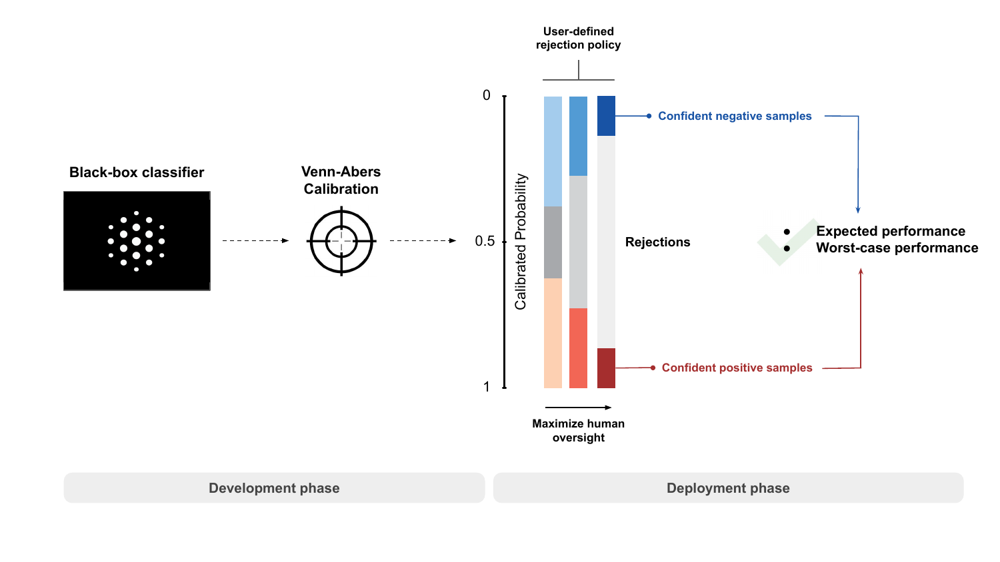

# Safe Deployment of Selective Classifiers: Reliable Performance Estimation with Venn-Abers Predictors





This repository contains experiments and plotting workflows for selective classification using calibrated confidence estimates. 

The core implementation can be found in in [`rejectlearn/`](rejectlearn/), while experiments are run from notebooks such as [`exp_performance.ipynb`](exp_performance.ipynb), [`ws_performance.ipynb`](ws_performance.ipynb), and [`example_plot.ipynb`](example_plot.ipynb). Input datasets are in [`data/`](data/), generated experiment outputs are stored in [`exp_performance_results/`](exp_performance_results/) and [`lower_bound_results/`](lower_bound_results/), and figures are written to [`plots/`](plots/).

## Dependencies

- `numpy`
- `scikit-learn`
- `venn-abers`
- `pandas`
- `xgboost`
- `tqdm`
- `scipy`
- `matplotlib`
- `seaborn`
- `ucimlrepo`
- `critdd`
- `jupyter`


## Example usage

The `RejectionClassifier` wraps a scikit-learn compatible classifier and exposes a selective-classification API based on either raw probabilities (`naive`), calibrated probabilities (`sigmoid`, `isotonic`), or Venn-Abers intervals (`regva`, `avgva`).

### 1. Basic selective classification with the `naive` mechanism

This example fits the underlying classifier directly and then evaluates selective performance at a target rejection rate.

```python
import numpy as np
from sklearn.datasets import load_breast_cancer
from sklearn.ensemble import RandomForestClassifier
from sklearn.model_selection import train_test_split

from rejectlearn.rejection import RejectionClassifier

# Binary classification dataset
X, y = load_breast_cancer(return_X_y=True)

X_train, X_test, y_train, y_test = train_test_split(
	X,
	y,
	test_size=0.25,
	stratify=y,
	random_state=0,
)

rc = RejectionClassifier(
	estimator=RandomForestClassifier(),
	mechanism="naive",
)
rc.fit(X_train, y_train)

selection = rc.selective_predict(X_test, rejection_rate=0.2)
metrics = rc.evaluate_selective_performance(
	X_test,
	y_test,
	rejection_rate=0.2,
)

print("Accepted samples:", metrics["n_accepted"])
print("Coverage:", metrics["coverage"])
print("Estimated accuracy:", metrics["estimate"])
print("Observed accuracy:", metrics["accuracy"])
print("Absolute estimation error:", metrics["error"])

# Access accepted predictions if needed
accepted_predictions = selection["predictions"][selection["accepted_mask"]]
```

### 2. Selective classification with Venn-Abers bounds

The `regva` and `avgva` mechanisms assume the base estimator is already fitted. A common workflow is to split the training data into a proper-training set and a calibration set, fit the model on the proper-training set, and fit `RejectionClassifier` on the calibration set with `cv="prefit"`.

```python
from sklearn.datasets import load_breast_cancer
from sklearn.model_selection import train_test_split
from xgboost import XGBClassifier

from rejectlearn.rejection import RejectionClassifier

X, y = load_breast_cancer(return_X_y=True)

X_train, X_test, y_train, y_test = train_test_split(
	X,
	y,
	test_size=0.25,
	stratify=y,
	random_state=0,
)

X_prop, X_cal, y_prop, y_cal = train_test_split(
	X_train,
	y_train,
	test_size=0.33,
	stratify=y_train,
	random_state=0,
)

base_clf = XGBClassifier()
base_clf.fit(X_prop, y_prop)

rc = RejectionClassifier(
	estimator=base_clf,
	mechanism="regva",
	cv="prefit",
)
rc.fit(X_cal, y_cal)

selection = rc.selective_predict(X_test, rejection_rate=0.2)
estimate = rc.estimate_selective_performance(X_test, rejection_rate=0.2)
metrics = rc.evaluate_selective_performance(X_test, y_test, rejection_rate=0.2)

print("Coverage:", metrics["coverage"])
print("Estimated accuracy:", metrics["estimate"])
print("Observed accuracy:", metrics["accuracy"])
print("Lower bound estimate:", metrics["lower_bound"])
print("Upper bound estimate:", metrics["upper_bound"])

# selection also includes the Venn-Abers bounds
lower_bounds = selection["lower_bounds"]
upper_bounds = selection["upper_bounds"]
```

### 3. Probability outputs

For `naive`, `sigmoid`, and `isotonic`, `predict_proba(X)` returns the usual class-probability array.

```python
proba = rc.predict_proba(X_test)
```

For `regva` and `avgva`, `predict_proba(X)` returns three arrays: calibrated probabilities, lower bounds, and upper bounds.

```python
va_proba, lower_bounds, upper_bounds = rc.predict_proba(X_test)
```

### 4. Threshold-based selection

Instead of specifying a rejection rate, you can select samples by a fixed confidence threshold.

```python
selection = rc.selective_predict(X_test, threshold=0.8)
metrics = rc.evaluate_selective_performance(X_test, y_test, threshold=0.8)
```

